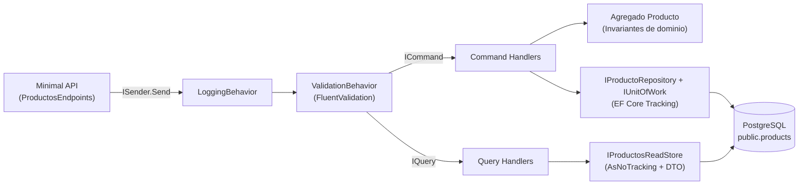

# Productos CQRS (.NET 10 + PostgreSQL)

API REST de gestión de productos construida con **.NET 10 (Minimal API)** aplicando **Clean Architecture** y **CQRS** (*Command Query Responsibility Segregation*) con un **mediator propio y liviano** (sin MediatR), validaciones transversales con **FluentValidation**, persistencia con **Entity Framework Core + PostgreSQL** y respuestas de error estandarizadas bajo **ProblemDetails (RFC 9457)**.

---

## Arquitectura y flujo CQRS

La solución separa explícitamente las operaciones que modifican el estado (**Commands**) de las consultas de lectura (**Queries**):

- **Lado de escritura (Commands):** pasa por el pipeline del mediator (`LoggingBehavior` → `ValidationBehavior`), carga o crea el agregado raíz `Producto` mediante `IProductoRepository`, ejecuta invariantes de dominio y persiste los cambios con `IUnitOfWork`.
- **Lado de lectura (Queries):** pasa por el mismo pipeline (`LoggingBehavior` → `ValidationBehavior`), pero consulta directamente `IProductosReadStore` con `AsNoTracking()` y proyección directa a `ProductoResponse`, sin instanciar agregados ni rastrear entidades.



### Capas de la solución

| Proyecto | Responsabilidad | Dependencias |
| :--- | :--- | :--- |
| `Productos.Cqrs.Domain` | Agregado raíz `Producto`, entidad base `Entity`, `DomainException` e interfaces del lado de escritura (`IProductoRepository`, `IUnitOfWork`). C# puro, sin dependencias externas. | Ninguna |
| `Productos.Cqrs.Application` | Contratos e implementación del mediator propio (`ISender`, `Sender`), pipeline behaviors (`LoggingBehavior`, `ValidationBehavior`), Commands, Queries, Validators y `IProductosReadStore`. | `Domain`, `FluentValidation.DependencyInjectionExtensions`, `Microsoft.Extensions.Logging.Abstractions` |
| `Productos.Cqrs.Infrastructure` | `ProductosDbContext`, mapeo Fluent API (`ProductoConfiguration`), `ProductoRepository`, `ProductosReadStore`, traducción de error único de PostgreSQL (`NombreProductoDuplicadoException`) y registro de `TimeProvider.System`. | `Application`, `Npgsql.EntityFrameworkCore.PostgreSQL` |
| `Productos.Cqrs.Api` | *Composition Root*, Minimal API (`ProductosEndpoints`), manejo global de excepciones (`GlobalExceptionHandler`), OpenAPI y Scalar. | `Application`, `Infrastructure`, `Microsoft.AspNetCore.OpenApi`, `Scalar.AspNetCore` |

---

## Estructura del repositorio

```text
05-Productos-CQRS/
├── Directory.Build.props               # Configuración común (net10.0, Nullable, ImplicitUsings)
├── Directory.Packages.props            # Central Package Management (versiones de paquetes)
├── Productos.Cqrs.sln
└── src/
    ├── Productos.Cqrs.Domain/
    │   ├── Common/
    │   │   └── Entity.cs               # Entidad base (Id) y DomainException
    │   └── Productos/
    │       ├── IProductoRepository.cs  # IProductoRepository e IUnitOfWork
    │       └── Producto.cs             # Agregado raíz y reglas de negocio
    ├── Productos.Cqrs.Application/
    │   ├── Abstractions/
    │   │   ├── Data/IProductosReadStore.cs
    │   │   └── Messaging/Contracts.cs  # IRequest, ICommand, IQuery, ISender, IPipelineBehavior
    │   ├── Behaviors/
    │   │   ├── LoggingBehavior.cs      # Logueo y medición de tiempos con Stopwatch
    │   │   └── ValidationBehavior.cs   # Ejecución automática de validadores FluentValidation
    │   ├── Common/
    │   │   ├── NombreProductoDuplicadoException.cs
    │   │   └── NotFoundException.cs
    │   ├── Messaging/
    │   │   └── Sender.cs               # Despachador con caché de wrappers por tipo
    │   ├── Productos/
    │   │   ├── Commands/
    │   │   │   ├── ActualizarPrecio/
    │   │   │   ├── ActualizarProducto/
    │   │   │   ├── AjustarStock/
    │   │   │   ├── CrearProducto/
    │   │   │   └── EliminarProducto/
    │   │   ├── Queries/
    │   │   │   ├── ListarProductos.cs
    │   │   │   └── ObtenerProducto.cs
    │   │   └── Responses.cs            # ProductoResponse y mapeo ToResponse
    │   └── DependencyInjection.cs
    ├── Productos.Cqrs.Infrastructure/
    │   ├── Persistence/
    │   │   ├── Configurations/ProductoConfiguration.cs
    │   │   ├── ProductoRepository.cs
    │   │   └── ProductosDbContext.cs
    │   ├── ReadModels/
    │   │   └── ProductosReadStore.cs
    │   └── DependencyInjection.cs
    └── Productos.Cqrs.Api/
        ├── Endpoints/
        │   ├── ProductosEndpoints.cs
        │   └── ProductosRequests.cs
        ├── ExceptionHandling/
        │   └── GlobalExceptionHandler.cs
        ├── Properties/launchSettings.json
        ├── Productos.http              # Colección de requests HTTP para pruebas manuales
        ├── Program.cs
        └── appsettings.json
```

---

## Stack tecnológico

- **.NET 10** (`net10.0`)
- **ASP.NET Core Minimal APIs** + `Microsoft.AspNetCore.OpenApi` (`10.0.15`) + `Scalar.AspNetCore` (`2.20.0`)
- **Entity Framework Core** + `Npgsql.EntityFrameworkCore.PostgreSQL` (`10.0.4`)
- **FluentValidation** (`12.2.0`)
- **PostgreSQL**

---

## Requisitos previos y base de datos

1. **[.NET 10 SDK](https://dotnet.microsoft.com/download/dotnet/10.0)**
2. **PostgreSQL** en ejecución.

Este proyecto no utiliza migraciones de EF Core: mapea directamente contra una tabla preexistente `public.products` en la base `bootcamp_db` (referenciada en comentarios del código como `01_create_tables.sql`, script externo a este repositorio).

Si necesitas crear la tabla desde cero, el esquema esperado según `ProductoConfiguration` y `ProductosDbContext` es equivalente a:

```sql
CREATE TABLE IF NOT EXISTS public.products (
    id          INTEGER GENERATED BY DEFAULT AS IDENTITY,
    name        VARCHAR(150) NOT NULL,
    description VARCHAR(500) NULL,
    price       NUMERIC(18, 2) NOT NULL,
    stock       INTEGER NOT NULL,
    created_at  TIMESTAMPTZ NOT NULL,
    updated_at  TIMESTAMPTZ NULL,
    CONSTRAINT pk_products PRIMARY KEY (id),
    CONSTRAINT ck_products_name CHECK (length(btrim(name)) > 0),
    CONSTRAINT ck_products_price CHECK (price >= 0),
    CONSTRAINT ck_products_stock CHECK (stock >= 0)
);

CREATE UNIQUE INDEX IF NOT EXISTS ux_products_name_lower
    ON public.products (lower(name));
```

---

## Configuración y ejecución

### 1. Configurar la cadena de conexión

La API lee `ConnectionStrings:BootcampDb` desde `appsettings.json` (o desde `appsettings.Development.json` / *User Secrets*, ignorados en `.gitignore`).

En `src/Productos.Cqrs.Api/appsettings.json`:

```json
{
  "ConnectionStrings": {
    "BootcampDb": "Host=localhost;Port=5432;Database=bootcamp_db;Username=bootcamp_user;Password=YOUR_PASSWORD"
  }
}
```

También puedes configurarla con *User Secrets* sin modificar archivos versionados:

```bash
dotnet user-secrets --project src/Productos.Cqrs.Api set "ConnectionStrings:BootcampDb" "Host=localhost;Port=5432;Database=bootcamp_db;Username=bootcamp_user;Password=TU_PASSWORD"
```

### 2. Compilar y ejecutar

```bash
dotnet restore
dotnet build
dotnet run --project src/Productos.Cqrs.Api
```

Con el perfil por defecto (`Development` en `launchSettings.json`), la aplicación escucha en:

- **API Base URL:** `http://localhost:5105`
- **Scalar UI (documentación interactiva):** `http://localhost:5105/scalar`
- **Documento OpenAPI:** `http://localhost:5105/openapi/v1.json`

---

## Endpoints de la API

Todos los endpoints están agrupados bajo `/api/productos`:

| Método | Ruta | Descripción | Caso de uso CQRS | Respuesta exitosa |
| :--- | :--- | :--- | :--- | :--- |
| `GET` | `/api/productos` | Lista productos (filtro opcional `?nombre=`, búsqueda parcial *case-insensitive*) | `ListarProductosQuery` | `200 OK` |
| `GET` | `/api/productos/{id}` | Obtiene un producto por su `id` | `ObtenerProductoQuery` | `200 OK` |
| `POST` | `/api/productos` | Crea un nuevo producto | `CrearProductoCommand` | `201 Created` |
| `PUT` | `/api/productos/{id}` | Actualiza nombre, descripción y precio | `ActualizarProductoCommand` | `200 OK` |
| `PATCH` | `/api/productos/{id}` | Actualiza únicamente el precio | `ActualizarPrecioCommand` | `200 OK` |
| `PATCH` | `/api/productos/{id}/stock` | Ajusta el stock (`cantidad > 0` entrada, `cantidad < 0` salida) | `AjustarStockCommand` | `200 OK` |
| `DELETE` | `/api/productos/{id}` | Elimina un producto | `EliminarProductoCommand` | `204 No Content` |

### Ejemplo de payload y respuesta

**Crear producto (`POST /api/productos`):**

```json
{
  "nombre": "Teclado Mecanico",
  "descripcion": "Teclado con switches rojos",
  "precio": 850000,
  "stockInicial": 40
}
```

**Respuesta (`ProductoResponse`):**

```json
{
  "id": 1,
  "nombre": "Teclado Mecanico",
  "descripcion": "Teclado con switches rojos",
  "precio": 850000.00,
  "stock": 40,
  "valorInventario": 34000000.00,
  "fechaCreacion": "2026-11-27T23:55:00+00:00",
  "fechaActualizacion": null
}
```

Puedes probar todos los escenarios (casos exitosos y de error) directamente desde tu IDE utilizando [`src/Productos.Cqrs.Api/Productos.http`](src/Productos.Cqrs.Api/Productos.http).

---

## Reglas de negocio y manejo de errores

`GlobalExceptionHandler` traduce las excepciones a **ProblemDetails (RFC 9457)** diferenciando errores de entrada/formato de las invariantes del dominio:

| Código HTTP | Excepción | Origen |
| :--- | :--- | :--- |
| `400 Bad Request` | `ValidationException` | Reglas de formato en FluentValidation (nombre vacío o > 150 caracteres, descripción > 500, precio fuera de `0..9999999999999999.99` o > 2 decimales, stock inicial negativo, ajuste `cantidad == 0`, nombre duplicado detectado previamente). |
| `400 Bad Request` | `NombreProductoDuplicadoException` | Violación de unicidad del índice `ux_products_name_lower` capturada en `ProductosDbContext.SaveChangesAsync`. |
| `404 Not Found` | `NotFoundException` | Producto inexistente para el `id` solicitado. |
| `422 Unprocessable Entity` | `DomainException` | Violación de invariante en el agregado `Producto` (por ejemplo, intentar descontar más stock del disponible dejando saldo negativo). |
| `500 Internal Server Error` | Cualquier otra excepción | Errores no controlados (registrados en log). |
